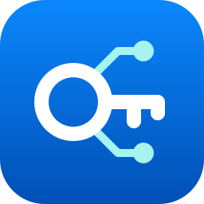
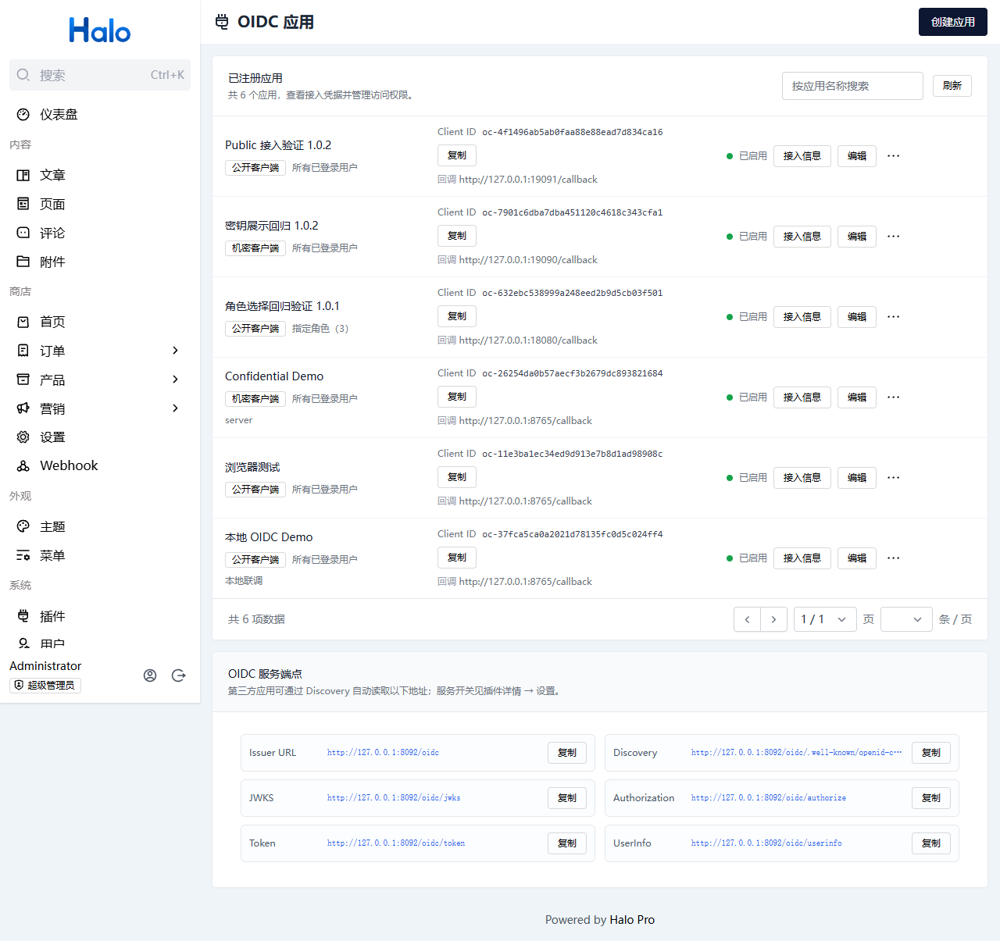
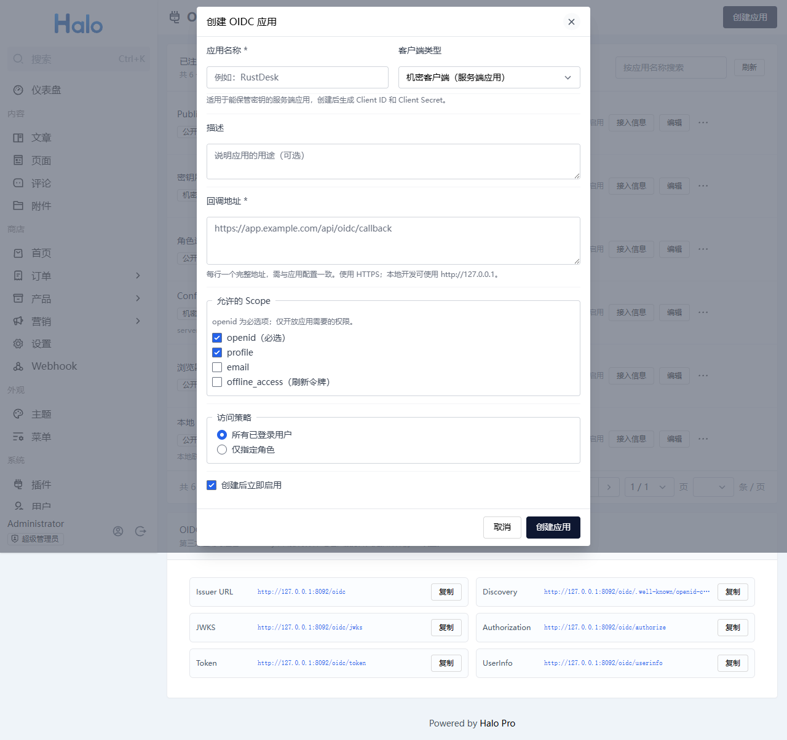
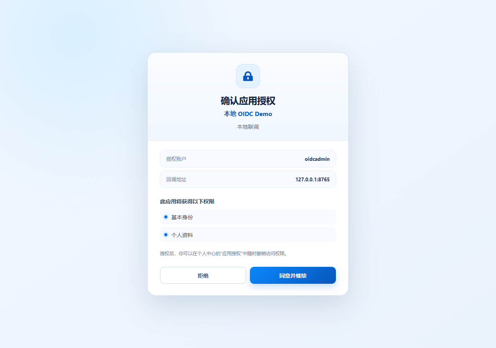

<p align="center">
  
</p>

# OIDC 服务端

为 Halo 提供 OpenID Connect 身份提供方能力，使用现有 Halo 账户登录第三方应用。管理员注册应用、按 Halo 角色控制应用访问，用户在授权前确认权限，并可以在个人中心撤销授权。

[](https://www.halo.run)
[](https://openjdk.org/projects/jdk/21/)
[](LICENSE)

- 插件标识：`oidc-server`
- 项目/仓库：[`halo-plugin-oidc-server`](https://github.com/ilay1678/halo-plugin-oidc-server)
- 作者：[`ilay`](https://github.com/ilay1678)

## 功能

| 功能 | 说明 |
| --- | --- |
| 应用管理 | 创建、编辑、启用/停用、删除应用和重置客户端密钥 |
| 角色访问策略 | 允许所有有效登录用户，或要求拥有所选角色之一 |
| 用户确认 | 展示应用和所申请权限，用户同意或拒绝 |
| 授权管理 | 在个人中心查看和撤销自己的应用授权 |
| 授权码登录 | public 客户端必须使用 PKCE S256；confidential 客户端可选，使用时严格校验 |
| OIDC Discovery | 标准发现文档、JWKS、RS256 ID Token；应用列表提供实际端点说明 |
| 用户身份 | UserInfo 按已同意的 Scope 输出个人资料和邮箱 |
| 长期授权 | `offline_access`、刷新令牌轮换、重放检测与令牌族撤销 |
| 令牌管理 | RFC 7009 撤销和 confidential 客户端 Introspection |

## 界面预览

以下截图展示管理员应用管理、应用创建配置和用户授权确认页面。截图中的应用名称、回调地址和账号均为本地演示数据，实际内容以你的 Halo 实例为准。

### 应用管理



### 创建应用



### 用户授权确认



## 安装与配置

需要 Halo **2.26.0 或更高版本**，Halo 使用 Java 21。通过 Halo Console 的「插件」上传构建后的 JAR，启用后刷新 Console 和个人中心。

在 Halo 中配置正确的外部访问地址，例如 `https://halo.example.com`。OIDC issuer 为该地址加 `/oidc`：`https://halo.example.com/oidc`。issuer 使用管理员配置的固定地址，不使用请求中的 Host 推导。生产环境使用 HTTPS；HTTP 仅支持本机环回地址用于开发。

打开插件详情 →「设置」→「服务开关」，开启「启用 OIDC 服务」后协议端点才会接受请求；同一页面还可以配置令牌有效期。启用协议前，确认 Halo 外部地址与第三方应用配置一致。

管理员在「OIDC 服务端」页面创建应用。超级管理员具有默认权限；其他管理员需在 Halo 角色中授予「OIDC 应用管理」权限。

## 创建应用

1. 填写应用名称和说明，选择客户端类型。默认 confidential，适合能安全保管密钥的服务器应用；SPA、移动端等无法保管密钥的应用选择 public。客户端类型创建后不可修改。
2. 填写完整的回调 URI，每行一个。回调必须逐字匹配，包括协议、主机、端口、路径和查询字符串；不支持通配符和 fragment。
3. 选择应用允许请求的权限。应用登录必须包含 `openid`；可选 `profile`、`email` 和 `offline_access`。
4. 明确选择访问策略。指定角色时至少选择一个角色，用户拥有其中任意一个即可；管理员身份也需满足策略。
5. 创建成功后自动展示接入信息，并提供 Client ID 和 Client Secret 的复制按钮。confidential 应用的 Client Secret 仅在创建或重置后显示一次，及时保存至应用的秘密配置；public 应用使用 Client ID 与 PKCE，不生成密钥。

应用列表展示客户端类型、访问策略、状态、Client ID 和回调地址，可复制 Client ID 或点击「接入信息」查看配置。启用/停用、重置密钥和删除在每行的更多操作中。再次查看 confidential 应用时不会返回原密钥；密钥丢失时使用「重置密钥」生成新的凭据。

角色控制的是应用访问资格。满足角色条件的用户仍需同意授权；同意授权不会赋予用户新的 Halo 角色，也不会向第三方应用授予 Halo 管理 API 权限。

停用应用后旧授权码和令牌失效，重新启用不会恢复这些令牌。删除应用或重置密钥后，第三方需要重新进行授权。

## 用户授权与撤销

第三方应用将浏览器跳转到授权端点。未登录时使用 Halo 原生登录，兼容已有的 Passkey、两步验证等登录方式；插件不接收或存储用户密码。

授权确认页说明应用、当前账户、回调主机及请求的身份数据。点击「同意并继续」后跳转回应用并返回授权码；点击「拒绝」也会返回应用，携带 `error=access_denied` 和原始 `state`。以后请求已经同意的相同权限时可以复用授权，`prompt=consent` 强制再次确认。

用户进入个人中心的「个人资料 → 应用授权」，可以撤销任意应用授权。撤销后相关授权码、访问令牌和刷新令牌无法继续在插件中使用。应用访问和令牌刷新会重新检查账户状态、应用策略与当前角色，移除角色后不能继续获取身份或刷新令牌。

**撤销范围：**第三方已经保存的 ID Token 可在到期前离线验证，第三方已有会话由该应用管理。撤销授权不会自动退出第三方应用，首版不提供 back-channel logout 或 RP-Initiated Logout。

## OIDC 接入

推荐第三方使用成熟 OIDC 客户端库。设置 issuer `https://halo.example.com/oidc`，通过 Discovery 读取真实端点，不自行拼接认证请求或忽略 ID Token 校验。

| 端点 | 方法 | 用途 |
| --- | --- | --- |
| Issuer URL：`https://halo.example.com/oidc` | — | OIDC 签发者标识，第三方客户端配置此地址 |
| `/oidc/.well-known/openid-configuration` | GET | OIDC Discovery |
| `/.well-known/openid-configuration` | GET | 同一 issuer 的站点根发现入口 |
| `/oidc/jwks` | GET | 签名公钥 |
| `/oidc/authorize` | GET / POST | 授权与同意确认 |
| `/oidc/token` | POST | 授权码换取令牌、刷新令牌 |
| `/oidc/userinfo` | GET / POST | 访问令牌获取身份 |
| `/oidc/revoke` | POST | 撤销令牌 |
| `/oidc/introspect` | POST | confidential 应用查询自身令牌状态 |

### Scope

| Scope | 身份数据或能力 |
| --- | --- |
| `openid` | 必需，稳定的 `sub` 身份标识和 ID Token |
| `profile` | 显示名、用户名、可用头像 |
| `email` | 邮箱与邮箱验证状态 |
| `offline_access` | 显式同意后获得刷新令牌 |

### 授权码与 PKCE 示例

以下以服务器应用为例，回调 URI `https://app.example.com/callback` 已在 Halo 登记。每次登录生成新的随机 `state`、`nonce` 和 `code_verifier`，在应用会话中保存。

```js
import { randomBytes, createHash } from 'node:crypto'

const verifier = randomBytes(32).toString('base64url')
const challenge = createHash('sha256').update(verifier).digest('base64url')
const state = randomBytes(32).toString('base64url')
const nonce = randomBytes(32).toString('base64url')

const authorizationUrl = new URL('https://halo.example.com/oidc/authorize')
authorizationUrl.search = new URLSearchParams({
  client_id: process.env.OIDC_CLIENT_ID,
  response_type: 'code',
  redirect_uri: 'https://app.example.com/callback',
  scope: 'openid profile email',
  state,
  nonce,
  code_challenge: challenge,
  code_challenge_method: 'S256',
}).toString()
// 将 state、nonce、verifier 保存至用户会话，随后跳转 authorizationUrl。
```

回调收到 `code` 前先检查 `state` 与会话值一致，拒绝错误响应或不匹配值。令牌请求使用 `application/x-www-form-urlencoded`：

```js
const tokenResponse = await fetch('https://halo.example.com/oidc/token', {
  method: 'POST',
  headers: { 'Content-Type': 'application/x-www-form-urlencoded' },
  body: new URLSearchParams({
    grant_type: 'authorization_code',
    client_id: process.env.OIDC_CLIENT_ID,
    client_secret: process.env.OIDC_CLIENT_SECRET,
    code: callbackCode,
    redirect_uri: 'https://app.example.com/callback',
    code_verifier: verifier,
  }),
})
if (!tokenResponse.ok) throw new Error('OIDC 令牌兑换失败')
const tokens = await tokenResponse.json()
```

public 客户端省略 `client_secret`，仍必须使用 PKCE S256。confidential 客户端可以省略 PKCE，也可以使用 PKCE；如果授权请求带有 PKCE，换令牌时必须提交匹配的 `code_verifier`，不能降级为无 PKCE。confidential 客户端可改用 `client_secret_basic`；一次请求只使用一种客户端认证方式。

通过 OIDC 库和 JWKS 验证 ID Token 签名、`iss`、`aud`、`exp`、`nonce` 和 `at_hash`。随后使用访问令牌获取身份：

```js
const response = await fetch('https://halo.example.com/oidc/userinfo', {
  headers: { Authorization: `Bearer ${tokens.access_token}` },
})
if (!response.ok) throw new Error('OIDC 身份查询失败')
const identity = await response.json()
// identity.sub 必须与已验证的 ID Token 的 sub 相同。
```

需要刷新令牌时，应用登记并申请 `offline_access`，用户明确同意。刷新请求使用 `grant_type=refresh_token`、最新 `refresh_token` 和客户端认证信息。每次成功刷新后立即替换旧刷新令牌；旧值重放会撤销同一令牌族，不适合并行刷新。

### 支持范围

支持 `response_type=code`、`response_mode=query`、`authorization_code` / `refresh_token`、public 客户端必需的 PKCE S256、confidential 客户端可选的 PKCE S256、`prompt=consent` / `none`。不支持隐式、密码、客户端凭证、设备授权、动态客户端注册和跨应用退出。

应用仅使用 opaque 访问令牌调用插件 UserInfo / Introspection；它不能用于认证 Halo API。协议声明以 Discovery 为准，不声明未实现的认证能力。

## 开发与构建

### 目录结构

后端按职责划分 Java 包，根包仅保留插件入口；测试按对应职责组织，共享测试数据和存储模拟放在 `support` 包。

```text
src/main/java/top/ilay/oidcserver/
├── OidcServerPlugin.java  # 插件生命周期、扩展模型与索引注册
├── config/               # Spring 配置与插件设置读取
├── extension/            # Halo 持久化扩展模型与授权绑定
├── dto/                  # 管理 API 请求、响应与分页模型
├── service/              # 应用、授权、身份、签名与令牌服务
├── web/                  # 管理和用户 API、授权控制器与页面
├── protocol/             # OAuth/OIDC 参数校验、错误与协议过滤器
├── reconciler/           # 过期授权码、令牌与令牌族清理
└── util/                 # 加密与扩展资源状态工具

src/test/java/top/ilay/oidcserver/
├── OidcServerPluginTest.java
├── service/              # 业务服务与安全回归测试
├── web/                  # 授权页面、跳转与权限提示测试
├── protocol/             # 协议过滤器测试
└── support/              # 共享测试环境与存储模拟

src/main/resources/       # 插件清单、设置、角色模板与 Logo
ui/src/                   # Console 和个人中心界面
docs/screenshots/         # README 界面截图
```

| 工具 | 要求 |
| --- | --- |
| Halo | ≥2.26.0 |
| JDK | 21，包含 `javac`；JRE 只能运行，不能编译 |
| Node.js | ≥22.12.0 |
| pnpm | 10.33.0，Gradle 可在工程内下载，无需全局安装 |

Windows 使用完整 JDK：

```powershell
./build-local.ps1 -JdkPath "D:/jdk/jdk-21.0.12.15" -GradleArguments @("build", "--console=plain")
```

macOS / Linux：

```bash
./gradlew build
```

产物位于 `build/libs`。构建包含后端测试、UI 类型/格式/lint 检查及完整 UI 资源打包。

本地开发可使用已有 Halo 实例；自动启动开发容器使用 `./gradlew haloServer`。只有需要独立实例时执行该命令，避免与已有端口冲突。

前端 API 来自后端的 Springdoc/OpenAPI，运行实例提供对应分组后执行：

```powershell
./build-local.ps1 -GradleArguments @("generateApiClient", "-x", "build", "--console=plain")
```

生成目录 `ui/src/api/generated` 为构建产物，不手工修改。普通配置使用 Halo Setting，私钥与客户端秘密验证值使用 Halo Secret，访问/刷新令牌只保存摘要。

## 反馈与许可证

在 [Issues](https://github.com/ilay1678/halo-plugin-oidc-server/issues) 反馈问题，提供 Halo/插件版本、复现流程和不含秘密的错误信息。不要附带 Client Secret、令牌、私钥或登录密码。

[GPL-3.0](LICENSE) © ilay
